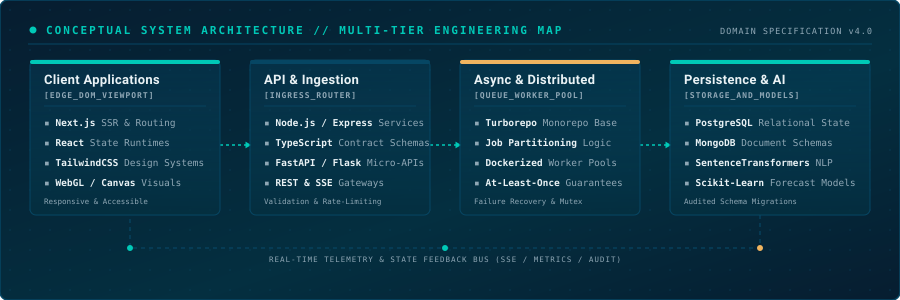
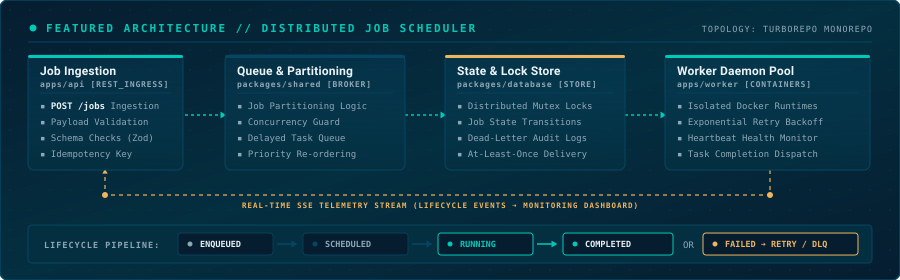
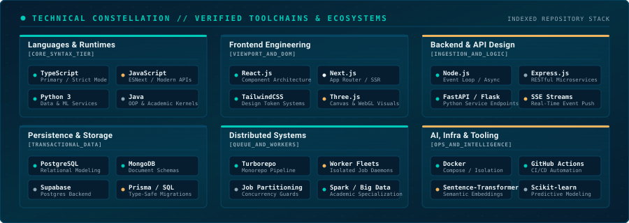
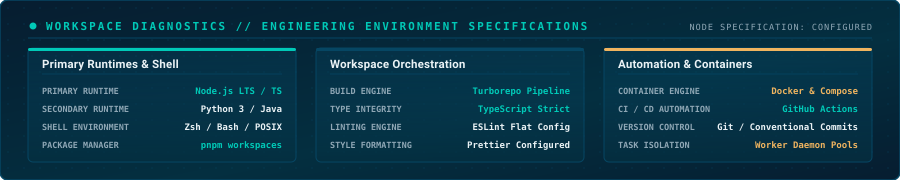

# Rahul Seervi — Engineering Profile

<p align="center">
  
</p>

<p align="center">
  <a href="#engineering-capabilities">
    
  </a>
  &nbsp;
  <a href="#featured-system">
    
  </a>
  &nbsp;
  <a href="#technical-constellation">
    
  </a>
  &nbsp;
  <a href="#academic-credentials">
    
  </a>
</p>

---

<p align="center">
  <code><a href="#system-architecture-overview">ARCHITECTURE</a></code> &nbsp;▪&nbsp;
  <code><a href="#engineering-capabilities">CAPABILITIES</a></code> &nbsp;▪&nbsp;
  <code><a href="#featured-system">FEATURED BUILD</a></code> &nbsp;▪&nbsp;
  <code><a href="#project-ledger">PROJECT LEDGER</a></code> &nbsp;▪&nbsp;
  <code><a href="#technical-constellation">STACK</a></code> &nbsp;▪&nbsp;
  <code><a href="#engineering-environment">ENVIRONMENT</a></code> &nbsp;▪&nbsp;
  <code><a href="#github-telemetry">TELEMETRY</a></code> &nbsp;▪&nbsp;
  <code><a href="#contact-connection">CONNECT</a></code>
</p>

---

## 📌 Introduction &amp; Engineering Positioning

Full-stack software engineer focused on resilient backend systems, distributed architectures, developer tooling, and intelligent software platforms. Specializing in high-concurrency event processing, decoupled service boundaries, and type-safe full-stack application development.

### Engineering Philosophy
> **"Resilience is not an afterthought; it is an architectural invariant."**  
> Scalable software systems require strict type boundaries, predictable error domains, decoupled ingestion-to-execution pipelines, and relentless developer experience automation.

---

<a id="system-architecture-overview"></a>
## 📐 System Architecture Overview

A conceptual topology of the engineering domains, lifecycle boundaries, and multi-tier components implemented across my workspaces:

<p align="center">
  
</p>

1. **Client Viewport Layer:** High-responsiveness web frontends and execution sandboxes built with **Next.js**, **React**, and **WebGL**.
2. **API &amp; Ingestion Layer:** Type-safe REST and Server-Sent Event (SSE) ingress controllers using **Node.js**, **Express**, and **FastAPI**.
3. **Async &amp; Distributed Processing:** Daemonized worker pools, partition locking brokers, and distributed mutex scheduling via **Turborepo** monorepo workspaces and **Docker**.
4. **Persistence &amp; AI Layer:** Relational state machines (**PostgreSQL**), unstructured document stores (**MongoDB**), and NLP semantic embedding models (**SentenceTransformers**).
5. **Observability Bus:** Continuous real-time status telemetry, lifecycle state push, and structured logging.

---

<a id="engineering-capabilities"></a>
## ⚡ Engineering Capabilities

### 1. Backend Engineering &amp; API Design
Architecting low-latency, modular HTTP and real-time APIs. Prioritizing strict schema validation (Zod, TypeScript), idempotent endpoint contracts, and graceful error handling across asynchronous service barriers.
- **Technologies:** `Node.js`, `TypeScript`, `Express`, `FastAPI`, `Python`, `REST`, `Server-Sent Events (SSE)`

### 2. Distributed Systems &amp; Background Processing
Designing fault-tolerant background scheduling engines and asynchronous execution pools. Implementing concurrency guards, retry backoffs, partitioned queue brokers, and dead-letter queue auditing.
- **Technologies:** `Turborepo Monorepos`, `Docker`, `pnpm workspaces`, `Worker Daemons`, `Concurrency Locks`

### 3. Full-Stack Product Engineering
Delivering responsive, accessible client interfaces linked with optimized backend pipelines. Focusing on component-driven UI systems, interactive state management, and client-side canvas rendering.
- **Technologies:** `Next.js (App Router)`, `React`, `TailwindCSS`, `Three.js / WebGL`, `Vite`

### 4. AI Integration &amp; Data Systems
Integrating predictive machine learning models, semantic search pipelines, and automated ATS matching into usable application workflows.
- **Technologies:** `SentenceTransformers`, `HuggingFace Models`, `Scikit-Learn`, `PostgreSQL`, `MongoDB`

---

<a id="featured-system"></a>
## 🚀 Featured System: Distributed Job Scheduler

<p align="center">
  
</p>

> **Repository:** [`TheCreativeCodeFlow/Distributed-job-Scheduler`](https://github.com/TheCreativeCodeFlow/Distributed-job-Scheduler)  
> **Architecture:** Microservices Monorepo &nbsp;|&nbsp; **Pattern:** Ingestion / Worker Separation &nbsp;|&nbsp; **Status:** `Active Development`

### The Problem
Traditional monolithic backends often combine API request processing and heavy asynchronous workloads on the same event loop. Under sudden traffic spikes, long-running tasks cause thread starvation, dropped HTTP connections, and uncoordinated worker crashes.

### The Architecture &amp; Implementation
- **Isolated Workspace Topology:** Structured as a high-velocity `pnpm` and `Turborepo` monorepo isolating `apps/api` (HTTP ingestion), `apps/worker` (execution daemon fleet), and `apps/web` (monitoring console), sharing schemas in `packages/shared` and `packages/database`.
- **At-Least-Once Delivery:** Guarantees task state persistence across worker failures via distributed mutex locks and atomic database state transitions.
- **Real-Time Lifecycle Broadcast:** Pushes job status changes (`ENQUEUED` ➔ `SCHEDULED` ➔ `RUNNING` ➔ `COMPLETED` / `FAILED`) directly to the monitoring terminal via Server-Sent Events (SSE).
- **Containerized Sandboxing:** Packaged with `Docker` and `docker-compose` to run independent, self-healing worker pools capable of horizontal scaling.

### Verified Stack
`TypeScript` • `Node.js` • `Turborepo` • `pnpm` • `Docker` • `PostgreSQL` • `Server-Sent Events (SSE)`

---

<a id="project-ledger"></a>
## 📁 Project Ledger

An indexed registry of engineering projects built across specific architectural constraints:

| Project | Domain / Focus | Key Technologies | Status |
| :--- | :--- | :--- | :--- |
| **[Distributed Job Scheduler](https://github.com/TheCreativeCodeFlow/Distributed-job-Scheduler)** | Distributed task queue, worker isolation, and real-time SSE telemetry | TypeScript, Node.js, Turborepo, Docker, Postgres | `Active Development` |
| **[CodeZilaa](https://github.com/TheCreativeCodeFlow/CodeZilaa)** | Line-by-line program execution visualizer and algorithmic practice sandbox | Next.js, React, TypeScript, TailwindCSS, Framer Motion | `Active Development` |
| **[MockPilot](https://github.com/TheCreativeCodeFlow/MockPilot)** | Dynamic mock API generation and automated testing harness | React, TypeScript, Vite, Node.js, Express, Docker | `Active Development` |
| **[CropCast](https://github.com/TheCreativeCodeFlow/CropCast)** | Predictive harvest forecasting utilizing microclimate ML models | Python, Scikit-Learn, React, Flask, MongoDB | `Active Development` |
| **[Memex](https://github.com/TheCreativeCodeFlow/Memex)** | Linked markdown knowledge visualizer with interactive force graph rendering | React, TypeScript, Vite, D3.js, Node.js | `Completed` |
| **[Cypher Resume Analyzer](https://github.com/TheCreativeCodeFlow/Cypher-Resume-Analyzer)** | Hybrid resume relevance evaluator matching profiles with SentenceTransformers NLP | Python, Streamlit, SentenceTransformers, HuggingFace | `Stable Release` |
| **[PharmaCare](https://github.com/TheCreativeCodeFlow/Pharmacy-Inventory-Management-System)** | Stock optimization dashboard with automated low-inventory alerts | React, Node.js, Express, Supabase, PostgreSQL | `Stable Release` |
| **[WebGL Portfolio](https://github.com/TheCreativeCodeFlow/About-ME)** | Interactive canvas visualizer using custom shaders and physics-based particles | Three.js, React, GSAP, WebGL, Lenis | `Stable Release` |
| **[University Management System](https://github.com/TheCreativeCodeFlow/University-Management-System)** | Academic administration portal handling student registration and course queues | Java / TypeScript, Spring Boot, MySQL, Thymeleaf | `Archived` |

---

<a id="technical-constellation"></a>
## 🌌 Technical Constellation

<p align="center">
  
</p>

### Domain Breakdown
- **Core Languages:** TypeScript (Strict Mode), JavaScript (ESNext), Python 3, Java.
- **Client &amp; Web:** React.js, Next.js (SSR / App Router), TailwindCSS, Three.js / WebGL.
- **Backend &amp; Ingestion:** Node.js, Express.js, FastAPI, Flask, Server-Sent Events (SSE).
- **Persistence &amp; Caching:** PostgreSQL, MongoDB, Supabase, Prisma ORM.
- **Distributed &amp; Monorepos:** Turborepo, pnpm workspaces, Worker Pools, Concurrency Locks.
- **Machine Learning &amp; AI:** SentenceTransformers, HuggingFace Models, Scikit-Learn.
- **Infrastructure &amp; Tooling:** Docker, Docker Compose, Git, GitHub Actions, ESLint Flat Config, Prettier.

---

<a id="engineering-environment"></a>
## ⚙️ Engineering Environment

<p align="center">
  
</p>

```text
WORKSPACE_SPECIFICATION ➔
├── RUNTIME_CORE    ➔ Node.js (Active LTS) / Python 3 / Java
├── TYPE_SYSTEM     ➔ TypeScript (Strict Mode: noImplicitAny, strictNullChecks)
├── MONOREPO_ENGINE ➔ Turborepo / pnpm isolated workspaces
├── CONTAINER_HOST  ➔ Docker Engine & Docker Compose Multi-Service Stacks
├── SHELL_PROFILE   ➔ Zsh / POSIX / Neovim Development Workflow
└── CODE_GOVERNANCE ➔ ESLint Flat Config / Prettier / Conventional Commits
```

---

<a id="academic-credentials"></a>
## 🏆 Achievements &amp; Academic Credentials

- **Academic Specialization:** B.Tech in Computer Science and Engineering (Specialization: **Big Data Analytics**) — *SRM Institute of Science and Technology*.
- **Certified Developer Credentials:**
  - **MongoDB Certified Developer** — Verified data modeling, aggregation pipelines, and document schema optimization.
  - **Android Certified Developer** — Verified application lifecycle architecture, thread dispatching, and mobile UI states.
- **Hackathon Participations:**
  - **Smart India Hackathon** — Engineered predictive analytical workflows and automated data aggregation pipelines.
  - **Tensor Hackathon** — Developed machine learning and semantic scoring architectures for domain-specific evaluation.

---

<a id="github-telemetry"></a>
## 📊 GitHub Telemetry

Continuous activity and repository metrics synchronized via automated GitHub Actions:

<p align="center">
  
</p>

<h4 align="center">ACTIVE CONTRIBUTION SNAKE</h4>

<p align="center">
  
</p>

> *Telemetry data is automatically generated and updated via a scheduled GitHub Actions workflow querying the GitHub GraphQL API.*

---

## 🧭 Current Engineering Focus

```text
CURRENT_INITIATIVES ➔
├── 🏗️ Scaling: High-throughput job partitioning & distributed worker pools
├── ⚡ Streaming: SSE event pipelines for real-time lifecycle synchronization
├── 📦 Tooling: Monorepo caching strategies with Turborepo & pnpm
└── 🧠 Experimenting: Semantic vector search & hybrid ATS scoring pipelines
```

---

<a id="contact-connection"></a>
## 🔌 Contact &amp; Connection

Feel free to reach out to discuss distributed systems, backend architectures, or open-source collaborations:

<p align="center">
  <a href="https://github.com/TheCreativeCodeFlow">
    
  </a>
  &nbsp;
  <a href="https://www.linkedin.com/in/rahul-seervi-thecreativecodeflow/">
    
  </a>
  &nbsp;
  <a href="https://rahulseervi.vercel.app/">
    
  </a>
  &nbsp;
  <a href="mailto:thecreativecodeflow@gmail.com">
    
  </a>
</p>

<br />

<p align="center">
  
</p>
